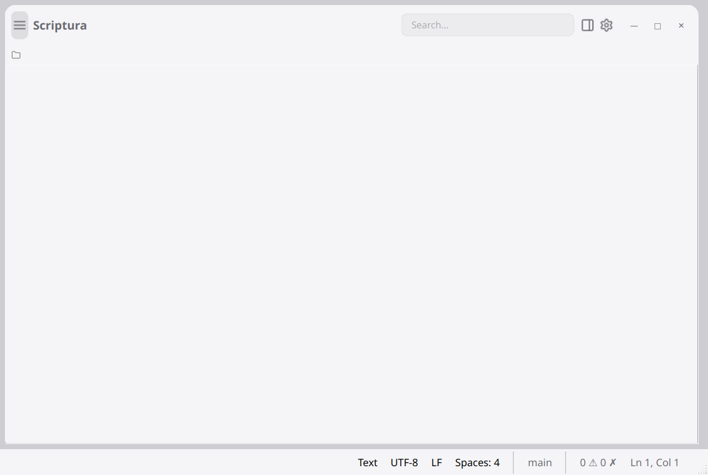

# Scriptura

Built by the [Nano Collective](https://nanocollective.org) — a community collective building AI tooling not for profit, but for the community.

A hybrid Qt and Rust code editor — Qt for the UI, Rust for safe backend services — with a local-first AI assistant built on [Nanocoder](https://github.com/Nano-Collective/nanocoder) still to come.

[](https://github.com/jason1015-coder/scriptura/actions/workflows/build.yml)
[](https://github.com/jason1015-coder/scriptura/actions/workflows/test.yml)



> **Status:** pre-1.0, and in active development. Expect bugs and occasional broken features.

---

## Architecture

Scriptura uses a **dual-language architecture**:

| Layer | Language | Technology | Responsibility |
|-------|----------|-----------|----------------|
| **UI Layer** | C++ | Qt 6 Widgets | All visual components (editor, panels, menus, dialogs) |
| **Adapter Layer** | C++ | Qt + C FFI | Thin wrappers bridging Qt signals/slots to Rust callbacks |
| **Backend Layer** | Rust | Pure Rust (no Qt) | LSP/DAP protocol, event bus, task runner, updater, workspace, config |

The backend services are compiled into a static library (`libscriptura_backend.a`) via **Cargo** and linked into the C++ executable. Cross-language communication uses **C FFI** (`extern "C"`) with JSON strings for complex data. All state management and protocol handling runs in safe Rust.

---

## Features

### Working

**Editor core (`src/codeeditor.*`, `src/mainwindow_tabs.cpp`)**
- Project workflow: open project / file-tree (`QFileSystemModel`) / expand-collapse / tabbed editing / save / save-as / recent projects-files / auto-save
- Syntax highlighting (`CodeHighlighter` + `languageregistry.*`), line numbers, current-line, indent guides, `LargeFileHandler`, `EncodingManager` (detect / BOM / LF-CRLF), smart-indent + bracket auto-close
- `BreadcrumbBarWidget` + `CssBreadcrumbParser` (html / css / scss / xml / svg)
- `FoldManager`, `BracketColorizer`, `MultiCursorManager` (`Ctrl+D`, above / below), `ColumnSelection`, `SnippetManager` + editor dialog, inlay-hints, ghost-text infra, `CodeLensManager`, `RefactoringManager`

**Search / navigate**
- `FindReplaceBar`, `ProjectSearchPanel` (bottom panel), `UniversalSearchPopup`, command palette, `ShortcutEditor`

**LSP (`src/mainwindow_lsp.cpp`, `rust_backend/src/lsp/`)**
- `start / stop / initialize / didOpen / didChange / didClose`, `completion / definition / declaration / implementation / typeDefinition / hover / references / rename / codeAction / documentSymbol / workspaceSymbol / formatting / signatureHelp`, diagnostics render + jump-to-error

**DAP / Run (`src/mainwindow_debug.cpp`, `services/dap/`, `rust_backend/src/dap/`)**
- `RunDialog`, `.vscode/launch.json` load / save, `startDebug / stopDebug`, breakpoint gutter, `continue / next / stepIn / stepOut / pause`, stack / scopes / variables / evaluate, run-without-debug via `QProcess`

**Tasks / Git (basic)**
- Rust `task_runner.rs` + `TaskRunnerUI` bottom panel + `Ctrl+Shift+B`, detects `package.json` / `Makefile` / `Cargo` tasks
- Git commit / push / pull / fetch via `QProcess`, `GitBlame` gutter + Rust `blame_engine` / `diff_engine`, status-bar branch

**Rust backend (`src/rust_backend/src/ffi.rs`, 122 `pub extern "C"`)**
- `eventbus`, `workspace` (folders / settings / recent), `updater` + `version_fetcher` (Stable / Pre-release check), `config_validator`, `language_registry` + `language_server_manager`, `session_engine` (restore + hot-exit), `filewatcher`, `diff / encoding / blame / emmet / test / ui_actions`, `framer`

**Themes / shell**
- `ThemeManager` (8 families × Light / Dark) + `ThemeIcons`, `CustomTitleBar`, `WindowAnimator`, `WelcomeMenuScreen`, `StatusBarWidget`, `NotificationCenter`, `ZenMode`, `SplitManager`
- Tests: `cargo test` + 30 `tests/test_*.cpp` (`ctest`), CI `build.yml` / `test.yml` on Linux / macOS / Windows

### Partially implemented (present but incomplete or unwired)

- (none currently)
- `rust_backend/src/config_validator.rs`: only JSON well-formedness, no schema enforcement

### Planned (explicit placeholders / TODOs)

- Inspector drawer (`mainwindow.cpp:485-578`): sparkle placeholder + `AI Assistant is in development` + `Coming soon — intelligent code assistance, refactoring suggestions`
- `TODO: nanocoder assistant in here` (`mainwindow.cpp:551`); `TODO: nanocoder settings UI (AI & Completions section goes here)` (`mainwindow_theme.cpp:347`)

### Roadmap

1. `nanocoder` AI assistant (inspector) + inline completion + `AI & Completions` settings
2. Wire in or remove the legacy `Minimap` / `Breadcrumb` widgets
3. Schema-aware `ConfigValidator`
4. Prod hardening toward `v1`: macOS sign / notarize

---

## Requirements

- **Qt 6** (with Widgets, Network, Sql, and LinguistTools modules)
- **CMake 3.16+**
- **C++17 compiler** (GCC, Clang, MSVC)
- **Rust toolchain** (for building the backend) — install via [rustup](https://rustup.rs):

```bash
curl --proto =https --tlsv1.2 -sSf https://sh.rustup.rs | sh
```

---

## Building

### Quick build and run (Debug)

```bash
./run.sh
```

> `./run.sh` builds the Rust backend and the Qt UI incrementally, then launches the app.

### Build (Release)

```bash
cmake -B cmake-build-Release -S . -DCMAKE_BUILD_TYPE=Release
cmake --build cmake-build-Release -j$(nproc)
```

### Manual build

```bash
# Build Rust backend first
cd src/rust_backend && cargo build --release && cd ../..

# Build C++ project
cmake -B build -S . -DCMAKE_BUILD_TYPE=Release
cmake --build build --config Release -j$(nproc)
```

### Running

```bash
./run.sh
```

Or directly:

```bash
./cmake-build-Debug/scriptura
```

---

## Downloads

Prebuilt binaries are produced by CI (`.github/workflows/build.yml` / `deploy.yml`).

### macOS — the app is NOT notarized or signed

The macOS build (`scriptura.app`) is **unsigned and not notarized** (no Apple Developer account is configured in CI). macOS Gatekeeper will therefore block the first launch with *"“Scriptura” can’t be opened because it is from an unidentified developer"* or *"damaged and can’t be opened"*.

**Option 1 — Right-click Open (easiest)**

1. In **Finder**, locate `scriptura.app` (do NOT use Launchpad).
2. **Control-click** (or right-click) the app and choose **Open**.
3. In the dialog, click **Open** again. The app is now whitelisted for future launches.

**Option 2 — Terminal (removes the quarantine flag)**

```bash
xattr -cr /path/to/scriptura.app
```

Run this once after downloading/extracting the app, then open it normally.

**Option 3 — Allow apps from anywhere (macOS Sequoia+ may need this)**

```bash
sudo spctl --master-disable   # allows apps from "Anywhere" in System Settings > Privacy & Security
# ... open the app, then optionally re-enable:
sudo spctl --master-enable
```

> If macOS still reports the app as *damaged*, Option 2 (`xattr -cr`) is the reliable fix — it clears the `com.apple.quarantine` attribute added when the archive was downloaded.

---

## Project structure

```
scriptura/
├── src/
│   ├── rust_backend/         # Rust backend library (Cargo project)
│   │   ├── Cargo.toml
│   │   └── src/
│   │       ├── lib.rs         # Module tree & helpers
│   │       ├── ffi.rs         # All C FFI exports (122 functions)
│   │       ├── eventbus.rs    # Pub/sub event system
│   │       ├── lsp/           # LSP protocol client
│   │       ├── dap/           # DAP protocol client
│   │       ├── task_runner.rs, updater.rs, ...
│   │       └── workspace.rs, language_registry.rs, ...
│   ├── rust_adapter.cpp/h     # C++ wrappers bridging Qt ↔ Rust FFI
│   ├── *.cpp, *.h, *.ui       # Qt UI layer (code editor, panels, etc.)
│   ├── main.cpp               # Application entry point
│   └── ...
├── include/
│   └── scriptura/
│       ├── rust_backend.h     # C FFI header for all backend services
│       └── scriptura_actions.h # UI action/command names shared with Rust
├── tests/                    # ctest suites for the Qt/C++ layer
├── translations/             # Qt Linguist sources
├── .github/workflows/        # CI/CD workflows
└── CMakeLists.txt            # CMake build system
```

---

## Plugins

Scriptura has a small plugin system for **themes** today (more kinds are planned). Plugins are plain JSON manifest files that live in the editor's settings data directory, so they travel with the user's configuration rather than the install.

### Where plugins live

```text
<settings dir>/plugins/
```

`ThemeManager::pluginsDir()` resolves this path at runtime (decision #7). On each startup the editor scans this directory and loads every valid manifest.

### Theme plugin format

A theme plugin is a single JSON file whose **filename stem must equal its `id`**. The shared manifest envelope is:

| Field       | Required | Notes                                                       |
|-------------|----------|-------------------------------------------------------------|
| `id`        | yes      | Non-empty, must match the filename stem (e.g. `my-theme.json` → `my-theme`) |
| `name`      | yes      | Display name                                                |
| `version`   | yes      | Valid [semver](https://semver.org/)                         |
| `kind`      | no       | `"theme"` (default). Unknown kinds are rejected.           |
| `apiVersion`| no       | Defaults to `1`. Must not exceed the host's supported API (`HOST_API_VERSION`, currently `1`). |
| `theme`     | no       | Default theme config (family/mode) for all themes in the pack |
| `themes`    | no       | Array of theme variants (replaces single `theme` for multi-theme packs) |

The `theme` object may omit any field; the editor merges what it is given onto the built-in palette for the chosen family/mode, so a partial theme still resolves to a complete `ThemeDefinition`.

**Single theme (legacy format):**
```json
{
  "id": "my-theme",
  "name": "My Theme",
  "version": "1.0.0",
  "kind": "theme",
  "theme": {
    "family": "blue",
    "mode": "dark",
    "colors": {
      "bgColor": "#1a1b1e",
      "textColor": "#afafb6"
    }
  }
}
```

**Multiple themes (new format):**
```json
{
  "id": "my-theme-pack",
  "name": "My Theme Pack",
  "version": "1.0.0",
  "kind": "theme",
  "theme": { "family": "blue", "mode": "dark" },
  "themes": [
    {
      "id": "variant-a",
      "name": "Variant A",
      "theme": { "colors": { "bgColor": "#111111" } }
    },
    {
      "id": "variant-b",
      "name": "Variant B",
      "theme": { "colors": { "bgColor": "#222222" } }
    }
  ]
}
```

Each theme in `themes` has its own `id` and `name`, and optionally its own `theme` config. The plugin-level `theme` provides defaults (family/mode) inherited by all variants. The resolved theme IDs use the format `plugin-id:theme-id` (e.g., `my-theme-pack:variant-a`).

### Installing a theme

1. Create the JSON file above.
2. Place it in `<settings dir>/plugins/`.
3. Restart Scriptura (or open **Appearance → Themes** and pick it).

The settings directory is created on first run; see `SettingsStore::storageDirectory()` for the platform-specific path.

### Developing a plugin

- **One file per plugin.** Each plugin is a single `.json` file in the plugins directory; there is no separate code to compile for theme plugins.
- **Filename = id.** The file must be named `<id>.json` or it is rejected at scan time.
- **Validate before shipping.** The registry checks `id`/filename match, semver `version`, known `kind`, and `apiVersion` ≤ the host's supported API. Malformed JSON is skipped silently.
- **Enable/disable is per-plugin.** Toggling a plugin off persists it under the settings key `plugin/disabled/<id>` and survives restarts. Disabled plugins are recorded with `state: "disabled"` and resolve no payload.
- **Built-in kinds are immutable.** The `theme` kind is built into the editor and cannot be overridden or removed by plugins. New kinds can be registered at runtime by the Rust backend (see `plugin_registry.rs`), but the add-only registry rejects duplicate kind ids.
- **Built-in palette.** The C++ `ThemeManager::buildDefinition` holds the canonical color map. The Rust `theme_engine` only supplies a minimal fallback for its own tests; a theme manifest overrides individual color keys on top of the built-in base.

See `src/rust_backend/src/plugin_registry.rs` for the registry implementation and `src/rust_backend/src/theme_engine.rs` for the theme merge logic.

---

## Community

Scriptura is built by the [Nano Collective](https://nanocollective.org), a community collective building AI tooling not for profit, but for the community. The work needs a second maintainer as much as it needs code.

- **Contribute**: see [CONTRIBUTING.md](CONTRIBUTING.md) for development setup, coding standards, and the test gate
- **The collective**: [nanocollective.org](https://nanocollective.org) · [docs](https://docs.nanocollective.org) · [GitHub](https://github.com/Nano-Collective) · [Discord](https://discord.gg/ktPDV6rekE)
- **Support the work**: the [Support page](https://docs.nanocollective.org/collective/organisation/support) covers donations and sponsorship
- **Paid contribution**: the [Economics Charter](https://docs.nanocollective.org/collective/organisation/economics-charter) sets out how scoped paid bounties work
